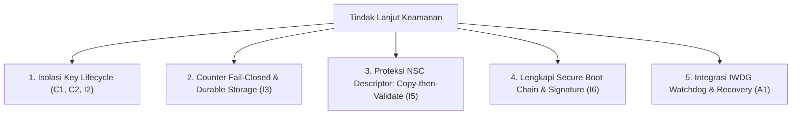

# Tinjauan Keamanan Komprehensif — STM32U585VIT6_SM

| Metadata | Keterangan |
|---|---|
| **Target Proyek** | Firmware 3-Phase AMI Smart Meter (STM32U585VIT6 Cortex-M33 + ADE9000) |
| **Tanggal Audit Awal** | 3 November 2026 |
| **Pembaruan & Adendum** | 16 November 2026 (Remediasi v2.21.0: F1/F2/C1/I5/A1/RDP) |
| **Cakupan** | Tinjauan statis source code (Secure/NonSecure), konfigurasi build, proteksi TrustZone-M, dan dokumentasi |
| **Di Luar Cakupan** | Pengujian penetrasi jaringan fisik/remote live, injeksi kesalahan fisik (fault injection/side-channel), dan eksekusi exploit target produksi |

---

## 1. Ringkasan Eksekutif (Executive Summary)

Tinjauan keamanan kode sumber mengidentifikasi **dua temuan tingkat tinggi (HIGH) dan satu temuan tingkat menengah (MEDIUM)** yang menjadi fokus utama kesiapan produksi, disertai evaluasi menyeluruh terhadap arsitektur kerahasiaan (*Confidentiality*), integritas/autentikasi (*Integrity*), dan ketersediaan (*Availability*).

Temuan-temuan ini adalah hasil analisis tingkat kode sumber (*source-level findings*). Tinjauan tidak menemukan bukti adanya celah eksploitasi jarak jauh (*remote exploit*) yang aktif secara langsung pada firmware bawaan (*stock*), karena port komunikasi UART fisik dan jalur otentikasi jaringan berada dalam kondisi terisolasi saat evaluasi dilakukan.

### Tiga Temuan Kunci (Key Findings)

| ID | Severity | Confidence | Lokasi Kode Sumber | Ringkasan Temuan |
|:---:|:---:|:---:|---|---|
| **F1 / I2** | **HIGH** | 9/10 | [`secure_nsc.c`](./Secure/Core/Src/secure_nsc.c), lines 112, 226–252, 491–513, 850–927 | **Potensi Bypass Otorisasi Secure Key-Management.** Pemanggil NonSecure berpotensi memanipulasi alur pembuktian HLS/token provisi untuk mengubah status otorisasi global dan mentransfer kunci. Kontrol otorisasi lifecycle kunci harus sepenuhnya terikat pada otentikasi sesi manufaktur/DLMS tepercaya. |
| **F2 / I6** | **HIGH** | 9/10 | [`main.c`](./Secure/Core/Src/main.c), lines 132–171, 180–187 | **Verifikasi Kriptografis Image NonSecure.** Sebelum eksekusi berpindah ke NonSecure world, pemeriksaan manifest header harus diperkuat dengan verifikasi tanda tangan digital (asymmetric signature) dan proteksi anti-rollback perangkat keras (Secure Flash/OB). |
| **F3 / I3** | **MEDIUM** | 8/10 | [`ami_nvm_counter.c`](./NonSecure/AMI/Src/ami_nvm_counter.c), lines 69–80, 106–125 | **Resiliensi Invocation Counter Terhadap Kegagalan Storage.** Penanganan kegagalan penulisan storage non-volatile (NVM) tidak boleh mengizinkan nilai counter RAM rollback ke nilai lama atau memajukan lease yang belum persisten, guna mencegah pemakaian ulang Nonce AES-128-GCM dan serangan replay. |

---

## 2. Matriks Status Temuan Audit (3 & 4 November 2026)

| ID | Area / Kategori | Severity Awal | Status Setelah Pembaruan Source | Rekomendasi / Tindak Lanjut |
|:---:|---|:---:|---|---|
| **C1** | Kunci Default & Persistensi | **HIGH** | **Dimitigasi di source (v2.21.0).** | `secure_flash_load_keys()` & `secure_flash_save_keys()` mengenkripsi kunci dengan AES-128-GCM terikat `UID_BASE` pada Page 126 Secure Flash (`0x0C0FC000`). |
| **C2** | Kunci Mentah di NonSecure | **HIGH** | **Telah dimitigasi di arsitektur.** | Firmware NonSecure kini hanya menggunakan opaque `AmiKeyHandle`. Larang penyalinan plaintext key. |
| **C3** | Atribut Keamanan SRAM3 | **HIGH\*** | **Source diperbarui; perlu verifikasi HW.** | Bitmask MPCBB/GTZC SRAM3 diatur ke `0xFFFFFFFF` (Secure/Privileged). Uji pada board target. |
| **I1** | Proof HLS & Disconnect Control | **HIGH\*** | **Perbaikan source diterapkan.** | Gateway NSC `SECURE_DLMS_HLS5_CalculateProof()` aktif. Verifikasi proof nol/salah ditolak keras. |
| **I2 / F1** | Otorisasi Key-Management | **HIGH** | **Dimitigasi di source (v2.21.0).** | `SECURE_DLMS_ResetSession()` & `SECURE_DLMS_SetSessionSap()` mengikat transfer kunci ke sesi HLS5 + Management SAP (1/16) dan mereset saat RLRQ/disconnect. |
| **I3 / F3** | Persistensi Invocation Counter | **MEDIUM** | **Guard telah ditambahkan.** | Penolakan strictly monotonic diterapkan; kegagalan lease write wajib fail-closed. |
| **I4** | RNG Fail-Closed | **MEDIUM** | **Perbaikan source diterapkan.** | Fallback pseudo-RNG (LCG) dihapus. Kegagalan TRNG mengembalikan error -2 dan membatalkan operasi. |
| **I5** | Descriptor NSC / TOCTOU | **MEDIUM** | **Dimitigasi di source (v2.21.0).** | Pola *copy-then-validate* diterapkan penuh di `SECURE_DLMS_AES_GCM_Process()` & `SECURE_DLMS_TransferKeys_Atomic()`, teruji di `AmiTrustZoneBoundaryTest`. |
| **I6 / F2** | Verifikasi Image & Rollback | **HIGH\*** | **Dimitigasi di source (v2.21.0).** | `SECURE_VerifyNonSecureImage()` memverifikasi SHA-256 kanonikal + tanda tangan **ECDSA P-256** (`ami_boot_crypto.c`) + anti-rollback `TAMP->BKP0R`, teruji di `AmiBootCryptoTest`. |
| **A1** | Pemulihan Error & Watchdog | **TBD** | **Dimitigasi di source (v2.21.0).** | `MX_IWDG_Init()` (~6s, *debug-freeze* ST-LINK) + `SECURE_Watchdog_Kick()` di FreeRTOS; `Error_Handler()` mencatat `TAMP->BKP1R` & memicu `NVIC_SystemReset()`. |

*\* Severity berlaku jika jalur komunikasi atau fitur terkait aktif dan dapat dicapai dari antarmuka luar.*

---

## 3. Detail Analisis Temuan (Detailed Findings)

### A. Confidentiality (Kerahasiaan)

#### C1. Kunci Operasional & Status Persistensi
- **Severity**: HIGH — **Confidence**: 9/10
- **Lokasi**: [`secure_nsc.c`](./Secure/Core/Src/secure_nsc.c), [`secure_nsc.h`](./Secure_nsclib/secure_nsc.h).
- **Analisis**: Kunci operasional (GUEK, GBEK, AK) dan status provisi yang disimpan di RAM volatil akan hilang saat reset/power-loss.
- **Validasi Aman**: Lakukan pengujian lifecycle kunci menggunakan kunci dummy pada lingkungan simulasi/host. Pastikan status provisi dan kunci disimpan secara terenkripsi di internal flash/BKP domain yang aman.

#### C2. Isolasi Kunci Mentah dari NonSecure World
- **Severity**: HIGH — **Confidence**: 9/10
- **Lokasi**: [`ami_dlms_cipher.h`](./NonSecure/AMI/Inc/ami_dlms_cipher.h), [`ami_dlms_cipher.c`](./NonSecure/AMI/Src/ami_dlms_cipher.c).
- **Analisis**: Konteks NonSecure dilarang menyimpan plaintext key. Kompromi pada layer NonSecure tidak boleh membocorkan material kunci root/master.
- **Validasi Aman**: Pastikan API NonSecure hanya mengonsumsi opaque handle (`AmiKeyHandle`) dan seluruh eksekusi kriptografi didelegasikan ke Secure World melalui NSC gateway.

#### C3. Penguncian Atribut Keamanan SRAM3
- **Severity**: HIGH (jika konfigurasi register menyimpang) — **Confidence**: 9/10
- **Lokasi**: [`main.c`](./Secure/Core/Src/main.c), [`STM32U585xx_FLASH_s.ld`](./Secure/STM32U585xx_FLASH_s.ld).
- **Analisis**: SRAM3 dialokasikan untuk data sensitif Secure World. Pengaturan MPCBB (Memory Protection Controller for Block-Based) dan register GTZC harus dikunci secara permanen saat inisialisasi boot.
- **Validasi Aman**: Verifikasi register `GTZC_MPCBB3_CR` dan status privilege pada hardware bench test terisolasi.

---

### B. Integrity (Integritas dan Autentikasi)

#### I1. Kalkulasi Proof HLS-5 (GMAC) & Otorisasi Kontrol Beban
- **Severity**: HIGH — **Confidence**: 9/10
- **Lokasi**: [`secure_nsc.c`](./Secure/Core/Src/secure_nsc.c), [`ami_dlms_port.c`](./NonSecure/AMI/Src/ami_dlms_port.c), [`ami_disconnect_control.c`](./NonSecure/AMI/Src/ami_disconnect_control.c).
- **Analisis**: Prosedur HLS-5 wajib menghasilkan GMAC tag 16-byte yang valid dan membandingkannya menggunakan *constant-time comparison* (`secure_memcmp`). Kontrol beban (Disconnect/Reconnect Class 70) hanya boleh dieksekusi setelah asosiasi HLS Management berstatus terotentikasi penuh.
- **Validasi Aman**: Uji dengan test suite host (`test_ami_security.c` & `test_ami_disconnect_control.c`); pastikan frame autentikasi invalid/nol selalu ditolak (*fail-closed*).

#### I2 / F1. Otorisasi API Key-Management Secure
- **Severity**: HIGH — **Confidence**: 9/10
- **Lokasi**: [`secure_nsc.c`](./Secure/Core/Src/secure_nsc.c#L112, L226–252, L491–513).
- **Analisis**: API pemindahan/pembaruan kunci tidak boleh bergantung pada token tetap atau status boolean global yang dapat disetel oleh pemanggil NonSecure.
- **Mitigasi**: Seluruh alur provisi kunci harus divalidasi di Secure World dengan challenge berbasis waktu/acak dan hak akses tingkat manufaktur.

#### I3 / F3. Persistensi & Resiliensi Invocation Counter (Anti-Replay)
- **Severity**: MEDIUM — **Confidence**: 9/10
- **Lokasi**: [`ami_nvm_counter.c`](./NonSecure/AMI/Src/ami_nvm_counter.c#L69–80, L106–125), [`ami_dlms_port.c`](./NonSecure/AMI/Src/ami_dlms_port.c).
- **Analisis**: Jika penulisan counter ke storage NVM gagal, RAM state tidak boleh memajukan lease secara sepihak yang dapat menyebabkan penggunaan nilai counter yang belum tersimpan durabel. Rollback counter membuka celah *AES-GCM nonce reuse* yang merusak kerahasiaan cipher.
- **Mitigasi**: Terapkan mekanisme *fail-closed*: setiap operasi enkripsi/dekripsi wajib membatalkan sesi jika counter storage gagal diperbarui secara persisten.

#### I4. Generator Bilangan Acak (TRNG) Wajib Fail-Closed
- **Severity**: MEDIUM — **Confidence**: 9/10
- **Lokasi**: [`secure_nsc.c`](./Secure/Core/Src/secure_nsc.c).
- **Analisis**: Kegagalan hardware TRNG (noise error, clock failure) tidak boleh menggunakan fallback pseudo-random generator deterministik (seperti LCG).
- **Mitigasi**: Mengembalikan error kode keras `-2`, membersihkan buffer output ke nol, dan menghentikan pembentukan challenge kriptografis.

#### I5. Proteksi Time-of-Check to Time-of-Use (TOCTOU) pada NSC Descriptor
- **Severity**: MEDIUM — **Confidence**: 8/10
- **Lokasi**: [`secure_nsc.c`](./Secure/Core/Src/secure_nsc.c#L535, L933).
- **Analisis**: Pointer struktur parameter yang dilewatkan dari NonSecure dapat diubah oleh peripheral DMA secara asinkron di antara waktu pemeriksaan (*check*) dan waktu penggunaan (*use*).
- **Mitigasi**: Terapkan prinsip *copy-then-validate*: salin seluruh struktur parameter ke Secure RAM lokal sebelum melakukan validasi batas memori dan eksekusi.

#### I6 / F2. Verifikasi Rantai Boot (Secure Boot & NonSecure Image)
- **Severity**: HIGH — **Confidence**: 9/10
- **Lokasi**: [`main.c`](./Secure/Core/Src/main.c#L132–171, L180–187).
- **Analisis**: Sebelum fungsi `SECURE_JumpToNonSecure()` dieksekusi, firmware Secure wajib memeriksa integritas dan keabsahan image NonSecure.
- **Mitigasi**: Saat ini telah diterapkan verifikasi manifest magic `0x504C4E21` (`PLN!`), rentang Stack Pointer NonSecure, alignment entry point, dan counter versi anti-rollback. Untuk target produksi, disarankan melengkapi dengan verifikasi tanda tangan digital (ECDSA P-256).

---

### C. Availability (Ketersediaan)

#### A1. Penanganan Error Sistem & Watchdog Recovery
- **Severity**: Evaluasi Arsitektur — **Confidence**: 8/10
- **Lokasi**: [`Secure/Core/Src/main.c`](./Secure/Core/Src/main.c), [`NonSecure/Core/Src/main.c`](./NonSecure/Core/Src/main.c).
- **Analisis**: Penggunaan loop tak berujung `while(1)` pada `Error_Handler()` tanpa intervensi watchdog hardware dapat menyebabkan meter berhenti beroperasi secara permanen saat terjadi lonjakan noise sesaat atau kesalahan bus I/O.
- **Mitigasi**: Integrasikan Independent Watchdog (IWDG) yang terhubung ke prosedur reset aman dengan pencatatan event kegagalan sistem pada tamper log.

---

## 4. Risiko Tambahan Terkait Target Hardware

1. **Atribusi & Kepemilikan Register Backup (`BKP0R` vs TAMP)**:
   - Secure boot memanfaatkan `BKP0R` untuk menyimpan epoch versi anti-rollback, sedangkan modul counter NonSecure memerlukan register retensi daya rendah.
   - Hak akses domain TAMP/RTC harus dikonfigurasi secara eksplisit di level hardware Secure startup agar tidak terjadi benturan bus (*bus fault*) saat NonSecure mengakses register status baterai/tamper.
2. **Keterbatasan Analisis Statis (Review Limitations)**:
   - Tinjauan ini merupakan audit statis terhadap kode sumber per 4 November 2026.
   - Skor *confidence* mencerminkan kepastian analisis kode sumber, bukan kepastian keterjadian eksploitasi di lapangan. Validasi definitif memerlukan pengujian langsung pada mikrokontroler STM32U585 fisik.

---

## 5. Prioritas Tindak Lanjut untuk Kesiapan Hardware

1. **Amankan Siklus Hidup Kunci (C1, C2, I2)**: Pastikan penyalinan material kunci mentah dihilangkan sepenuhnya dari build produksi dan operasi provisi terikat pada kanal manufaktur terisolasi.
2. **Jaminan Durable Counter (I3)**: Pastikan kegagalan penulisan flash/storage langsung membatalkan enkripsi transmisi, tanpa fallback ke status RAM sementara.
3. **Pola Salin Descriptor NSC (I5)**: Lindungi gateway NSC dari potensi manipulasi DMA asinkron dengan menyalin descriptor ke memori Secure terlebih dahulu.
4. **Verifikasi Rantai Booting (I6)**: Tinjau option bytes hardware (`RDP Level 0.5/1`, `TZEN=1`, `SECBOOTADD0`), manifest header, dan mekanisme signing firmware.
5. **Uji Bangku Laboratorium Berizin**: Lakukan validasi empiris atas retensi domain baterai, MPCBB SRAM3, peripheral TRNG, dan ketahanan terhadap malformed APDU.

---

## 6. Adendum Audit Menyeluruh — 16 November 2026

Adendum ini menambahkan temuan berdasarkan tinjauan statis source dan konfigurasi terbaru. Isi bagian sebelumnya tidak diubah. Tidak dilakukan pengujian pada board atau penetrasi terhadap perangkat live; hasil uji host bukan bukti validasi hardware.

| # | Severity | File | Lines | Vulnerability | Confidence |
|---|----------|------|-------|---------------|------------|
| 1 | 🟠 HIGH | [ami_dlms_port.c](./NonSecure/AMI/Src/ami_dlms_port.c) | 178-204 | Perintah pemutus/penyambung breaker plaintext dapat melewati pemeriksaan HLS dan ciphered APDU | 10/10 |
| 2 | 🟠 HIGH | [secure_nsc.c](./Secure/Core/Src/secure_nsc.c) | 149, 415-455, 699-734, 1083-1162 | Pemanggil NonSecure dapat membentuk otorisasi transfer key Secure menggunakan token tetap dan proof yang tidak terikat sesi | 9/10 |
| 3 | 🟠 HIGH | [main.c](./Secure/Core/Src/main.c), [CMakeLists.txt](./Secure/CMakeLists.txt) | 203-214; 48-50 | Secure boot dapat menerima image NonSecure tanpa manifest/tanda tangan ketika strict boot tidak diaktifkan | 10/10 |
| 4 | 🟡 MEDIUM | [secure_nsc.c](./Secure/Core/Src/secure_nsc.c), [main.c](./Secure/Core/Src/main.c) | secure_nsc.c: 88-96, 114-156, 189-207, 468-494; main.c: 351-362 | Kunci wrapping keystore dapat diturunkan dari UID publik dan konstanta build | 9/10 |
| 5 | 🟡 MEDIUM | [main.c](./Secure/Core/Src/main.c) | 169-200 | Epoch anti-rollback tidak terikat pada data yang ditandatangani | 9/10 |
| 6 | 🟡 MEDIUM | [ami_dlms_port.c](./NonSecure/AMI/Src/ami_dlms_port.c), [secure_nsc.c](./Secure/Core/Src/secure_nsc.c) | ami_dlms_port.c: 19-35; secure_nsc.c: 724-726, 1118-1120 | Jalur asosiasi HLS normal tidak menetapkan status Secure yang dibutuhkan sehingga key-transfer klien sah ditolak | 10/10 |

### 6.1 Detail Temuan

#### A2. Aksi breaker plaintext melewati autentikasi ciphered

- **Severity**: HIGH — **Confidence**: 10/10
- **Lokasi**: [ami_dlms_port.c](./NonSecure/AMI/Src/ami_dlms_port.c), baris 178-204.
- **Dampak**: Aksi disconnect/reconnect dapat diproses tanpa tag GCM atau pemeriksaan invocation counter, meskipun asosiasi berada dalam status `ASSOCIATED`.
- **Kondisi pemicu**: Kirim HDLC I-frame dengan SAP/alamat yang diterima dan APDU aksi Class 70 plaintext. Cabang pemroses memeriksa status asosiasi lalu memanggil aksi breaker, tanpa mewajibkan HLS/ciphering.
- **Perbaikan**: Wajibkan semua aksi operasional melewati jalur authenticated-ciphered dan menolak aksi plaintext pada asosiasi HLS. Tambahkan regresi yang menguji frame plaintext dan ciphered.

#### A3. Pemanggil NonSecure dapat mengotorisasi transfer key di Secure

- **Severity**: HIGH — **Confidence**: 9/10
- **Lokasi**: [secure_nsc.c](./Secure/Core/Src/secure_nsc.c), baris 149, 415-455, 699-734, 1083-1162.
- **Dampak**: Pada perangkat yang belum diprovisi, pemanggil NSC dapat mengatur key operasional pilihan sendiri tanpa peer HLS yang terautentikasi.
- **Kondisi pemicu**: Entry point provisi menerima token tetap `0x504C4E31`; alur proof menerima challenge dari pemanggil dan tidak mengikatnya pada challenge/sesi aktif yang dikelola Secure. Transfer key menerima SAP default `0`.
- **Perbaikan**: Ganti token tetap dengan mekanisme provisi pabrik terautentikasi. Kelola challenge, status sesi, peer identity, dan SAP di Secure; ikat otorisasi transfer ke asosiasi yang telah diverifikasi Secure, bukan nilai yang diberikan pemanggil.

#### A4. Secure boot mengizinkan image NonSecure tanpa tanda tangan pada konfigurasi build

- **Severity**: HIGH — **Confidence**: 10/10
- **Lokasi**: [main.c](./Secure/Core/Src/main.c), baris 203-214; [CMakeLists.txt](./Secure/CMakeLists.txt), baris 48-50.
- **Dampak**: Image NonSecure yang tidak ditandatangani dapat dijalankan jika memiliki vector table yang masuk akal.
- **Kondisi pemicu**: Manifest tidak ada atau magic-nya salah dan `AMI_STRICT_SECURE_BOOT` tidak aktif. Konfigurasi Secure yang diperiksa tidak mengaktifkan definisi strict tersebut.
- **Perbaikan**: Jadikan verifikasi strict sebagai default pada build deployable dan gagal tertutup untuk manifest hilang, tidak valid, atau tidak bertanda tangan. Pisahkan build development yang permissive secara eksplisit dari konfigurasi rilis.

#### C4. Wrapping key keystore dapat diturunkan dari UID publik

- **Severity**: MEDIUM — **Confidence**: 9/10
- **Lokasi**: [secure_nsc.c](./Secure/Core/Src/secure_nsc.c), baris 88-96, 114-156, 189-207, 468-494; [main.c](./Secure/Core/Src/main.c), baris 351-362.
- **Dampak**: Salinan flash keystore dapat dibuka jika penyerang memperoleh UID perangkat. UID tersedia untuk NonSecure dan wrapping key diturunkan dengan XOR UID dan konstanta compile-time.
- **Kondisi pemicu**: Penyerang memperoleh dump flash dan UID, misalnya pada perangkat dengan readout protection belum diterapkan. Kode yang diperiksa hanya mengubah proteksi tersebut ketika macro opt-in aktif.
- **Perbaikan**: Gunakan hardware unique secret yang tidak dapat diekspor dengan KDF standar untuk derivasi wrapping key dan terapkan readout protection produksi melalui konfigurasi provisioning yang terverifikasi.

#### I7. Epoch anti-rollback tidak tercakup tanda tangan image

- **Severity**: MEDIUM — **Confidence**: 9/10
- **Lokasi**: [main.c](./Secure/Core/Src/main.c), baris 169-200.
- **Dampak**: Pemeriksaan anti-rollback dapat dilewati meskipun strict boot aktif, dengan menaikkan epoch image lama yang tanda tangannya masih valid.
- **Kondisi pemicu**: Hash image tidak mencakup manifest, sementara tanda tangan ECDSA hanya memverifikasi `computed_hash`; `version_epoch` diperiksa terpisah dan tidak ikut ditandatangani.
- **Perbaikan**: Tanda tangani representasi manifest kanonis yang mencakup epoch dan seluruh field keamanan relevan, lalu uji bahwa perubahan field tersebut membatalkan verifikasi.

#### P1. Key-transfer klien sah ditolak oleh jalur asosiasi normal

- **Severity**: MEDIUM — **Confidence**: 10/10
- **Lokasi**: [ami_dlms_port.c](./NonSecure/AMI/Src/ami_dlms_port.c), baris 19-35; [secure_nsc.c](./Secure/Core/Src/secure_nsc.c), baris 724-726 dan 1118-1120.
- **Dampak**: HES yang berhasil menyelesaikan asosiasi HLS dapat gagal melakukan key-transfer melalui jalur DLMS normal.
- **Kondisi pemicu**: Callback HLS target menggunakan `SECURE_DLMS_HLS5_CalculateProof`, tetapi alur asosiasi tidak memanggil `SECURE_DLMS_HLS5_Verify`; fungsi Verify adalah jalur yang menetapkan `s_hls_authenticated_session`, yang diwajibkan oleh `SECURE_DLMS_TransferKeys_Atomic`.
- **Perbaikan**: Verifikasi proof HLS yang diterima di Secure dan ikat hasilnya pada sesi/asosiasi aktual sebelum transfer key diizinkan. Tambahkan uji integrasi untuk jalur sukses dan kegagalan otorisasi.

### 6.2 Catatan Validasi

- Jalur ciphered APDU memverifikasi GCM sebelum menerima invocation counter dan meneruskan request; temuan A2 adalah pengecualian pada jalur aksi breaker plaintext.
- Driver counter NonSecure mengakses register TAMP secara langsung, sementara konfigurasi Secure menandai TAMP sebagai Secure. Dampak target belum disimpulkan tanpa validasi hardware; jangan mengandalkan backend counter tersebut sebelum akses dan retensinya diuji pada board.
- Suite host yang tersedia lulus **16/16** pada 16 November 2026. Hasil ini tidak menguji perilaku TrustZone, TAMP, proteksi flash, atau aksi breaker pada hardware.
