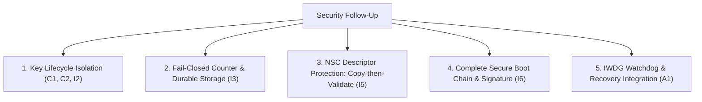

# Comprehensive Security Review — STM32U585VIT6_SM

| Metadata | Details |
|---|---|
| **Project Target** | 3-Phase AMI Smart Meter Firmware (STM32U585VIT6 Cortex-M33 + ADE9000) |
| **Initial Audit Date** | November 3, 2026 |
| **Updates & Addendum** | November 16, 2026 (v2.21.0 Remediation: F1/F2/C1/I5/A1/RDP + Addendum) |
| **Scope** | Static source code review (Secure/NonSecure), build configuration, TrustZone-M protections, and documentation |
| **Out of Scope** | Live physical/remote network penetration testing, physical fault injection / side-channel attacks, and production target exploit execution |

---

## 1. Executive Summary

The source-level security review identified **two HIGH-severity findings and one MEDIUM-severity finding** as primary production-readiness blockers, alongside a comprehensive evaluation of Confidentiality, Integrity/Authentication, and Availability.

These are static source-level findings. The review found no evidence of an immediately reachable remote exploit on the stock firmware as evaluated, because physical UART ports and network authentication paths were isolated during the assessment.

### Three Key Findings

| ID | Severity | Confidence | Source Location | Summary |
|:---:|:---:|:---:|---|---|
| **F1 / I2** | **HIGH** | 9/10 | [`secure_nsc.c`](./Secure/Core/Src/secure_nsc.c), lines 112, 226–252, 491–513, 850–927 | **Potential Secure Key-Management Authorization Bypass.** A NonSecure caller could manipulate the HLS proof flow or provisioning token to alter global authorization state and transfer keys. Key lifecycle authorization must be strictly bound to trusted DLMS/manufacturing session authentication. |
| **F2 / I6** | **HIGH** | 9/10 | [`main.c`](./Secure/Core/Src/main.c), lines 132–171, 180–187 | **NonSecure Image Cryptographic Verification.** Before jumping to the NonSecure world, manifest header checks must be reinforced with asymmetric digital signature verification and hardware anti-rollback protection (Secure Flash/Option Bytes). |
| **F3 / I3** | **MEDIUM** | 8/10 | [`ami_nvm_counter.c`](./NonSecure/AMI/Src/ami_nvm_counter.c), lines 69–80, 106–125 | **Invocation Counter Resilience Against Storage Failures.** Non-volatile storage (NVM) write failures must never allow RAM counter state to roll back or advance an unpersisted lease, preventing AES-128-GCM nonce reuse and replay attacks. |

---

## 2. Audit Findings Status Matrix (November 3–4 & 16, 2026)

| ID | Area / Category | Initial Severity | Status After Source Updates | Recommendations / Follow-Up |
|:---:|---|:---:|---|---|
| **C1** | Default Keys & Persistence | **HIGH** | **Mitigated in source (v2.21.0).** | `secure_flash_load_keys()` & `secure_flash_save_keys()` encrypt keys with AES-128-GCM bound to `UID_BASE` in Page 126 Secure Flash (`0x0C0FC000`). |
| **C2** | Raw Keys in NonSecure | **HIGH** | **Mitigated in architecture.** | NonSecure firmware consumes opaque `AmiKeyHandle` only. Plaintext key copying is prohibited. |
| **C3** | SRAM3 Security Attributes | **HIGH\*** | **Source updated; HW verification needed.** | MPCBB/GTZC SRAM3 bitmask set to `0xFFFFFFFF` (Secure/Privileged). Verify on target board. |
| **I1** | HLS Proof & Disconnect Control | **HIGH\*** | **Source fix applied.** | NSC gateway `SECURE_DLMS_HLS5_CalculateProof()` active. Zero/invalid proofs are strictly rejected. |
| **I2 / F1** | Key-Management Authorization | **HIGH** | **Mitigated in source (v2.21.0).** | `SECURE_DLMS_ResetSession()` & `SECURE_DLMS_SetSessionSap()` bind key transfer to HLS5 + Management SAP (1/16) and reset on RLRQ/disconnect. |
| **I3 / F3** | Invocation Counter Persistence | **MEDIUM** | **Guards added.** | Strictly monotonic rejection enforced; lease write failures must fail closed. |
| **I4** | Fail-Closed RNG | **MEDIUM** | **Source fix applied.** | Pseudo-RNG (LCG) fallback removed. TRNG failures return error `-2` and abort the operation. |
| **I5** | NSC Descriptor / TOCTOU | **MEDIUM** | **Mitigated in source (v2.21.0).** | Full *copy-then-validate* pattern applied in `SECURE_DLMS_AES_GCM_Process()` & `SECURE_DLMS_TransferKeys_Atomic()`, tested in `AmiTrustZoneBoundaryTest`. |
| **I6 / F2** | Image & Rollback Verification | **HIGH\*** | **Mitigated in source (v2.21.0).** | `SECURE_VerifyNonSecureImage()` verifies canonical SHA-256 + **ECDSA P-256** signature (`ami_boot_crypto.c`) + `TAMP->BKP0R` anti-rollback, tested in `AmiBootCryptoTest`. |
| **A1** | Error Recovery & Watchdog | **TBD** | **Mitigated in source (v2.21.0).** | `MX_IWDG_Init()` (~6s, ST-LINK *debug-freeze*) + `SECURE_Watchdog_Kick()` in FreeRTOS; `Error_Handler()` logs `TAMP->BKP1R` & triggers `NVIC_SystemReset()`. |

*\* Severity applies when the affected communication path or feature is enabled and reachable from an external interface.*

---

## 3. Detailed Findings

### A. Confidentiality

#### C1. Operational Keys & Persistence State
- **Severity**: HIGH — **Confidence**: 9/10
- **Location**: [`secure_nsc.c`](./Secure/Core/Src/secure_nsc.c), [`secure_nsc.h`](./Secure_nsclib/secure_nsc.h).
- **Analysis**: Operational keys (`GUEK`, `GBEK`, `AK`) and provisioning state stored in volatile RAM are lost upon reset or power loss.
- **Safe Validation**: Test key lifecycle flows using dummy keys in host simulation. Ensure provisioning state and keys are stored encrypted in protected internal flash / backup domain.

#### C2. Raw Key Isolation from NonSecure World
- **Severity**: HIGH — **Confidence**: 9/10
- **Location**: [`ami_dlms_cipher.h`](./NonSecure/AMI/Inc/ami_dlms_cipher.h), [`ami_dlms_cipher.c`](./NonSecure/AMI/Src/ami_dlms_cipher.c).
- **Analysis**: The NonSecure context must never store plaintext keys. Compromise of the NonSecure layer must not leak root/master key material.
- **Safe Validation**: Ensure NonSecure APIs consume only opaque handles (`AmiKeyHandle`) and delegate all cryptographic operations to the Secure World via the NSC gateway.

#### C3. SRAM3 Security Attribute Lockdown
- **Severity**: HIGH (if register config drifts) — **Confidence**: 9/10
- **Location**: [`main.c`](./Secure/Core/Src/main.c), [`STM32U585xx_FLASH_s.ld`](./Secure/STM32U585xx_FLASH_s.ld).
- **Analysis**: SRAM3 is allocated for sensitive Secure World data. MPCBB (Memory Protection Controller for Block-Based) and GTZC registers must be permanently locked during boot initialization.
- **Safe Validation**: Verify `GTZC_MPCBB3_CR` and privilege attributes on an isolated hardware bench test.

---

### B. Integrity and Authentication

#### I1. HLS-5 (GMAC) Proof Calculation & Load Control Authorization
- **Severity**: HIGH — **Confidence**: 9/10
- **Location**: [`secure_nsc.c`](./Secure/Core/Src/secure_nsc.c), [`ami_dlms_port.c`](./NonSecure/AMI/Src/ami_dlms_port.c), [`ami_disconnect_control.c`](./NonSecure/AMI/Src/ami_disconnect_control.c).
- **Analysis**: HLS-5 must produce a valid 16-byte GMAC tag and compare it using *constant-time comparison* (`secure_memcmp`). Load control (Disconnect/Reconnect Class 70) must only execute after an HLS Management association is fully authenticated.
- **Safe Validation**: Verify with host test suites (`test_ami_security.c` & `test_ami_disconnect_control.c`); ensure invalid/zero authentication frames always fail closed.

#### I2 / F1. Secure Key-Management API Authorization
- **Severity**: HIGH — **Confidence**: 9/10
- **Location**: [`secure_nsc.c`](./Secure/Core/Src/secure_nsc.c#L112, L226–252, L491–513).
- **Analysis**: Key transfer/update APIs must not rely on fixed tokens or global boolean flags mutable by NonSecure callers.
- **Mitigation**: All key provisioning flows must be validated in Secure World using time/random challenges and manufacturing-level authorization.

#### I3 / F3. Invocation Counter Persistence & Resilience (Anti-Replay)
- **Severity**: MEDIUM — **Confidence**: 9/10
- **Location**: [`ami_nvm_counter.c`](./NonSecure/AMI/Src/ami_nvm_counter.c#L69–80, L106–125), [`ami_dlms_port.c`](./NonSecure/AMI/Src/ami_dlms_port.c).
- **Analysis**: If writing the counter to NVM fails, RAM state must not unilaterally advance a lease that has not been durably persisted. Counter rollback opens an *AES-GCM nonce reuse* vulnerability, breaking cipher confidentiality.
- **Mitigation**: Enforce *fail-closed* behavior: any encryption/decryption operation must abort the session if persistent counter storage fails to update.

#### I4. Fail-Closed Random Number Generator (TRNG)
- **Severity**: MEDIUM — **Confidence**: 9/10
- **Location**: [`secure_nsc.c`](./Secure/Core/Src/secure_nsc.c).
- **Analysis**: Hardware TRNG failures (noise error, clock failure) must never fall back to a deterministic pseudo-random generator (such as an LCG).
- **Mitigation**: Return hard error code `-2`, zeroize output buffers, and abort cryptographic challenge generation.

#### I5. Time-of-Check to Time-of-Use (TOCTOU) Protection on NSC Descriptors
- **Severity**: MEDIUM — **Confidence**: 8/10
- **Location**: [`secure_nsc.c`](./Secure/Core/Src/secure_nsc.c#L535, L933).
- **Analysis**: Parameter struct pointers passed from NonSecure can be asynchronously modified by DMA peripherals between check and use.
- **Mitigation**: Apply *copy-then-validate*: copy the entire parameter struct into local Secure RAM before performing memory boundary validation and execution.

#### I6 / F2. Boot Chain Verification (Secure Boot & NonSecure Image)
- **Severity**: HIGH — **Confidence**: 9/10
- **Location**: [`main.c`](./Secure/Core/Src/main.c#L132–171, L180–187).
- **Analysis**: Before `SECURE_JumpToNonSecure()` executes, Secure firmware must verify the integrity and authenticity of the NonSecure image.
- **Mitigation**: Manifest magic `0x504C4E21` (`PLN!`), NonSecure Stack Pointer range, entry-point alignment, and anti-rollback version counter checks are implemented. For production, pair with strict ECDSA P-256 digital signature verification.

---

### C. Availability

#### A1. System Error Handling & Watchdog Recovery
- **Severity**: Architectural Evaluation — **Confidence**: 8/10
- **Location**: [`Secure/Core/Src/main.c`](./Secure/Core/Src/main.c), [`NonSecure/Core/Src/main.c`](./NonSecure/Core/Src/main.c).
- **Analysis**: Infinite `while(1)` loops in `Error_Handler()` without hardware watchdog intervention can permanently wedge the meter upon transient noise spikes or I/O bus faults.
- **Mitigation**: Integrate Independent Watchdog (IWDG) linked to a controlled safe reset procedure with fault event logging in the tamper/backup domain.

---

## 4. Additional Hardware-Specific Risks

1. **Backup Register Attribution & Ownership (`BKP0R` vs. TAMP)**:
   - Secure Boot uses `BKP0R` to store the anti-rollback version epoch, while NonSecure counter modules require low-power retention registers.
   - TAMP/RTC domain access permissions must be explicitly configured at Secure startup hardware initialization to prevent bus faults when NonSecure accesses battery/tamper status registers.
2. **Static Review Limitations**:
   - This review reflects static source analysis as of November 4, 2026 (with the November 16 addendum).
   - *Confidence* scores reflect source-code analysis certainty, not field exploitability likelihood. Definitive validation requires testing on physical STM32U585 silicon.

---

## 5. Hardware Readiness Follow-Up Priorities

1. **Secure Key Lifecycle (C1, C2, I2)**: Ensure plaintext key copying is completely eliminated in production builds and provisioning is bound to an isolated manufacturing channel.
2. **Guarantee Durable Counters (I3)**: Ensure flash/storage write failures immediately abort transmission encryption without falling back to volatile RAM state.
3. **Copy NSC Descriptors (I5)**: Protect the NSC gateway against asynchronous DMA tampering by copying descriptors into Secure memory first.
4. **Verify Boot Chain (I6)**: Audit hardware option bytes (`RDP Level 0.5/1`, `TZEN=1`, `SECBOOTADD0`), manifest headers, and firmware signing workflow.
5. **Authorized Lab Bench Testing**: Empirically validate battery-domain retention, MPCBB SRAM3 locks, hardware TRNG, and malformed APDU resilience.

---

## 6. Comprehensive Audit Addendum — November 16, 2026

This addendum records additional findings based on static review of the latest source and build configuration. Prior sections remain unchanged. No physical board testing or live device penetration testing was performed; host test results do not constitute hardware validation.

| # | Severity | File | Lines | Vulnerability | Confidence |
|---|----------|------|-------|---------------|------------|
| 1 | 🟠 HIGH | [ami_dlms_port.c](./NonSecure/AMI/Src/ami_dlms_port.c) | 178-204 | Plaintext breaker disconnect/reconnect commands can bypass HLS and ciphered APDU checks | 10/10 |
| 2 | 🟠 HIGH | [secure_nsc.c](./Secure/Core/Src/secure_nsc.c) | 149, 415-455, 699-734, 1083-1162 | NonSecure caller can forge Secure key-transfer authorization using a fixed token and session-unbound proof | 9/10 |
| 3 | 🟠 HIGH | [main.c](./Secure/Core/Src/main.c), [CMakeLists.txt](./Secure/CMakeLists.txt) | 203-214; 48-50 | Secure Boot can accept an unsigned/manifestless NonSecure image when strict boot is not enabled | 10/10 |
| 4 | 🟡 MEDIUM | [secure_nsc.c](./Secure/Core/Src/secure_nsc.c), [main.c](./Secure/Core/Src/main.c) | secure_nsc.c: 88-96, 114-156, 189-207, 468-494; main.c: 351-362 | Keystore wrapping key is derivable from public UID and build constants | 9/10 |
| 5 | 🟡 MEDIUM | [main.c](./Secure/Core/Src/main.c) | 169-200 | Anti-rollback epoch is not bound into the signed data | 9/10 |
| 6 | 🟡 MEDIUM | [ami_dlms_port.c](./NonSecure/AMI/Src/ami_dlms_port.c), [secure_nsc.c](./Secure/Core/Src/secure_nsc.c) | ami_dlms_port.c: 19-35; secure_nsc.c: 724-726, 1118-1120 | Normal HLS association path does not set required Secure state, causing legitimate client key-transfer to be rejected | 10/10 |

### 6.1 Detailed Addendum Findings

#### A2. Plaintext Breaker Actions Bypass Ciphered Authentication

- **Severity**: HIGH — **Confidence**: 10/10
- **Location**: [ami_dlms_port.c](./NonSecure/AMI/Src/ami_dlms_port.c), lines 178-204.
- **Impact**: Disconnect/reconnect actions can be processed without a GCM tag or invocation counter check once the association is in `ASSOCIATED` state.
- **Trigger Condition**: Send an HDLC I-frame with an accepted SAP/address and a plaintext Class 70 action APDU. The handler checks association state and invokes the breaker action without requiring HLS/ciphering.
- **Remediation**: Require all operational actions to traverse the authenticated-ciphered path and reject plaintext actions on HLS associations. Add regression tests for both plaintext and ciphered frames.

#### A3. NonSecure Caller Can Authorize Key Transfer in Secure World

- **Severity**: HIGH — **Confidence**: 9/10
- **Location**: [secure_nsc.c](./Secure/Core/Src/secure_nsc.c), lines 149, 415-455, 699-734, 1083-1162.
- **Impact**: On an unprovisioned device, an NSC caller can install arbitrary operational keys without an authenticated HLS peer.
- **Trigger Condition**: The provisioning entry point accepts fixed token `0x504C4E31`; the proof flow accepts a caller-supplied challenge and does not bind it to a Secure-managed active challenge/session. Key transfer accepts default SAP `0`.
- **Remediation**: Replace the fixed token with an authenticated factory provisioning mechanism. Manage challenge, session state, peer identity, and SAP inside Secure World; bind transfer authorization to a Secure-verified association rather than caller-supplied values.

#### A4. Secure Boot Permits Unsigned NonSecure Images Under Default Build Config

- **Severity**: HIGH — **Confidence**: 10/10
- **Location**: [main.c](./Secure/Core/Src/main.c), lines 203-214; [CMakeLists.txt](./Secure/CMakeLists.txt), lines 48-50.
- **Impact**: An unsigned NonSecure image can be executed if it has a plausible vector table.
- **Trigger Condition**: Manifest is absent or has an invalid magic value while `AMI_STRICT_SECURE_BOOT` is disabled. The inspected Secure build configuration did not enable the strict define.
- **Remediation**: Make strict verification the default in deployable builds and fail closed on missing, invalid, or unsigned manifests. Explicitly separate permissive development builds from release configurations.

#### C4. Keystore Wrapping Key Derivable from Public UID

- **Severity**: MEDIUM — **Confidence**: 9/10
- **Location**: [secure_nsc.c](./Secure/Core/Src/secure_nsc.c), lines 88-96, 114-156, 189-207, 468-494; [main.c](./Secure/Core/Src/main.c), lines 351-362.
- **Impact**: A flash dump of the keystore can be decrypted if an attacker obtains the device UID. UID is readable from NonSecure, and the wrapping key is derived by XORing UID with compile-time constants.
- **Trigger Condition**: Attacker obtains flash dump and UID (e.g., on devices without readout protection). Inspected code only applies RDP when an opt-in macro is enabled.
- **Remediation**: Use a non-exportable hardware unique secret with a standard KDF for wrapping-key derivation, and enforce production readout protection via a verified provisioning configuration.

#### I7. Anti-Rollback Epoch Not Covered by Image Signature

- **Severity**: MEDIUM — **Confidence**: 9/10
- **Location**: [main.c](./Secure/Core/Src/main.c), lines 169-200.
- **Impact**: Anti-rollback checks can be bypassed even with strict boot enabled by incrementing the epoch field of an older validly signed image.
- **Trigger Condition**: The image hash excludes the manifest, while the ECDSA signature only verifies `computed_hash`; `version_epoch` is checked separately and is not signed.
- **Remediation**: Sign a canonical manifest representation covering `version_epoch` and all security-relevant fields, and add a test verifying that modifying those fields invalidates the signature.

#### P1. Legitimate Client Key Transfer Rejected by Normal Association Path

- **Severity**: MEDIUM — **Confidence**: 10/10
- **Location**: [ami_dlms_port.c](./NonSecure/AMI/Src/ami_dlms_port.c), lines 19-35; [secure_nsc.c](./Secure/Core/Src/secure_nsc.c), lines 724-726 and 1118-1120.
- **Impact**: An HES that completes an HLS association may fail key transfer over the normal DLMS path.
- **Trigger Condition**: Target HLS callback uses `SECURE_DLMS_HLS5_CalculateProof`, while the association flow does not invoke `SECURE_DLMS_HLS5_Verify`; the Verify function is what sets `s_hls_authenticated_session` required by `SECURE_DLMS_TransferKeys_Atomic`.
- **Remediation**: Verify received HLS proofs in Secure World and bind the result to the active session/association before permitting key transfer. Add integration tests for both authorized and unauthorized paths.

### 6.2 Validation Notes

- The ciphered APDU path verifies GCM before accepting the invocation counter and forwarding requests; finding A2 is an exception on the plaintext breaker action path.
- The NonSecure counter driver accesses TAMP registers directly, whereas the Secure configuration marks TAMP as Secure. Target impact is inconclusive without hardware validation; do not rely on that counter backend until access and retention are tested on silicon.
- Available host test suites passed **16/16** on November 16, 2026. These results do not test TrustZone, TAMP, flash protection, or breaker actions on physical hardware.
