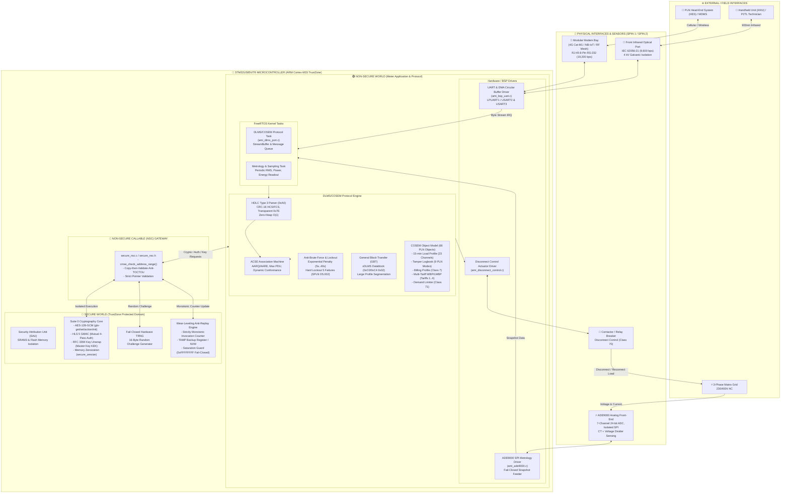
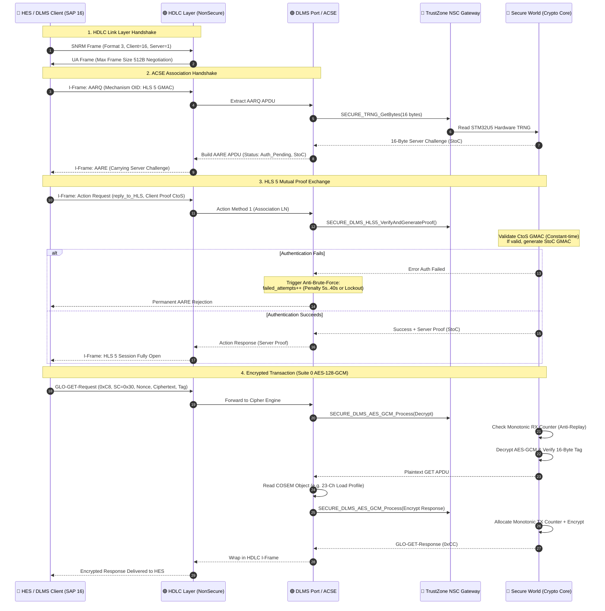
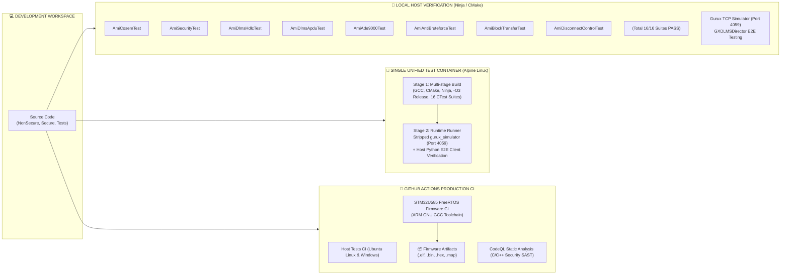
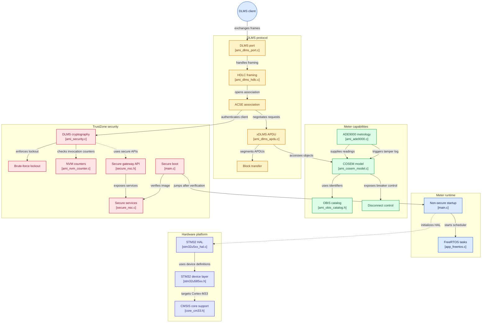

# 📐 Complete System Architecture — 3-Phase AMI Smart Meter
**Target: STM32U585VIT6 (ARM Cortex-M33 TrustZone) + ADE9000 AFE**  
*Standards Compliance: SPLN D3.006:2021, SPLN D5.002:2024, IEC 62056 (DLMS/COSEM)*

---

## 1. End-to-End System Block Diagram (Physical & Logical Topology)

---

## 2. Protocol & HLS5 (GMAC) Authentication Data Flow

---

## 3. Testing & CI/CD Pipeline Structure

# harrynurisnandar1-oss/stm32u585vit6_sm architecture

> Architecture diagram of the GitHub repository harrynurisnandar1-oss/stm32u585vit6_sm, generated by GitDiagram from its file tree, README and a sample of source files (last updated 2026-11-05). It is an AI-made overview: check details against the source.

- Interactive diagram: https://gitdiagram.com/harrynurisnandar1-oss/stm32u585vit6_sm
- Repository: https://github.com/harrynurisnandar1-oss/stm32u585vit6_sm

## Overview

This repository is firmware for a three-phase STM32U585/ADE9000 smart meter. Its main user workflow is a DLMS client sending HDLC frames: the non-secure communications stack handles framing and association, processes xDLMS requests against the COSEM meter model, and returns readings or controls the breaker. Security services run across the TrustZone boundary, while metrology supplies meter data. The README documents these product capabilities; sampled startup code confirms secure boot and non-secure scheduler startup, but most application-module call sites were not sampled, so those links rely on README evidence.

## Diagram (Mermaid)

## Components

### Meter runtime

- [Non-secure startup](https://github.com/harrynurisnandar1-oss/stm32u585vit6_sm/blob/main/NonSecure/Core/Src/main.c): `NonSecure/Core/Src/main.c`
- [FreeRTOS tasks](https://github.com/harrynurisnandar1-oss/stm32u585vit6_sm/blob/main/NonSecure/Core/Src/app_freertos.c): `NonSecure/Core/Src/app_freertos.c`

### DLMS protocol

- [DLMS port](https://github.com/harrynurisnandar1-oss/stm32u585vit6_sm/blob/main/NonSecure/AMI/Src/ami_dlms_port.c): `NonSecure/AMI/Src/ami_dlms_port.c`
- [HDLC framing](https://github.com/harrynurisnandar1-oss/stm32u585vit6_sm/blob/main/NonSecure/AMI/Src/ami_dlms_hdlc.c): `NonSecure/AMI/Src/ami_dlms_hdlc.c`
- [ACSE association](https://github.com/harrynurisnandar1-oss/stm32u585vit6_sm/blob/main/NonSecure/AMI/Src/ami_dlms_association.c): `NonSecure/AMI/Src/ami_dlms_association.c`
- [xDLMS APDU](https://github.com/harrynurisnandar1-oss/stm32u585vit6_sm/blob/main/NonSecure/AMI/Src/ami_dlms_apdu.c): `NonSecure/AMI/Src/ami_dlms_apdu.c`
- [Block transfer](https://github.com/harrynurisnandar1-oss/stm32u585vit6_sm/blob/main/NonSecure/AMI/Src/ami_dlms_block_transfer.c): `NonSecure/AMI/Src/ami_dlms_block_transfer.c`

### Meter capabilities

- [COSEM model](https://github.com/harrynurisnandar1-oss/stm32u585vit6_sm/blob/main/NonSecure/AMI/Src/ami_cosem_model.c): `NonSecure/AMI/Src/ami_cosem_model.c`
- [OBIS catalog](https://github.com/harrynurisnandar1-oss/stm32u585vit6_sm/blob/main/NonSecure/AMI/Inc/ami_obis_catalog.h): `NonSecure/AMI/Inc/ami_obis_catalog.h`
- [ADE9000 metrology](https://github.com/harrynurisnandar1-oss/stm32u585vit6_sm/blob/main/NonSecure/AMI/Src/ami_ade9000.c): `NonSecure/AMI/Src/ami_ade9000.c`
- [Disconnect control](https://github.com/harrynurisnandar1-oss/stm32u585vit6_sm/blob/main/NonSecure/AMI/Src/ami_disconnect_control.c): `NonSecure/AMI/Src/ami_disconnect_control.c`

### TrustZone security

- [DLMS cryptography](https://github.com/harrynurisnandar1-oss/stm32u585vit6_sm/blob/main/NonSecure/AMI/Src/ami_security.c): `NonSecure/AMI/Src/ami_security.c`
- [Brute-force lockout](https://github.com/harrynurisnandar1-oss/stm32u585vit6_sm/blob/main/NonSecure/AMI/Src/ami_anti_bruteforce.c): `NonSecure/AMI/Src/ami_anti_bruteforce.c`
- [NVM counters](https://github.com/harrynurisnandar1-oss/stm32u585vit6_sm/blob/main/NonSecure/AMI/Src/ami_nvm_counter.c): `NonSecure/AMI/Src/ami_nvm_counter.c`
- [Secure gateway API](https://github.com/harrynurisnandar1-oss/stm32u585vit6_sm/blob/main/Secure_nsclib/secure_nsc.h): `Secure_nsclib/secure_nsc.h`
- [Secure boot](https://github.com/harrynurisnandar1-oss/stm32u585vit6_sm/blob/main/Secure/Core/Src/main.c): `Secure/Core/Src/main.c`
- [Secure services](https://github.com/harrynurisnandar1-oss/stm32u585vit6_sm/blob/main/Secure/Core/Src/secure_nsc.c): `Secure/Core/Src/secure_nsc.c`

### Hardware platform

- [STM32 device layer](https://github.com/harrynurisnandar1-oss/stm32u585vit6_sm/blob/main/Drivers/CMSIS/Device/ST/STM32U5xx/Include/stm32u585xx.h): `Drivers/CMSIS/Device/ST/STM32U5xx/Include/stm32u585xx.h`
- [CMSIS core support](https://github.com/harrynurisnandar1-oss/stm32u585vit6_sm/blob/main/Drivers/CMSIS/Include/core_cm33.h): `Drivers/CMSIS/Include/core_cm33.h`
- [STM32 HAL](https://github.com/harrynurisnandar1-oss/stm32u585vit6_sm/blob/main/Drivers/STM32U5xx_HAL_Driver/Src/stm32u5xx_hal.c): `Drivers/STM32U5xx_HAL_Driver/Src/stm32u5xx_hal.c`

### Other components

- **DLMS client**

## Connections

- DLMS client → DLMS port: exchanges frames (evidence: `README.md`)
- DLMS port → HDLC framing: handles framing (evidence: `README.md`)
- HDLC framing → ACSE association: opens association (evidence: `README.md`)
- ACSE association → xDLMS APDU: negotiates requests (evidence: `README.md`)
- xDLMS APDU → COSEM model: accesses objects (evidence: `README.md`)
- xDLMS APDU → Block transfer: segments APDUs (evidence: `README.md`)
- COSEM model → OBIS catalog: uses identifiers (evidence: `NonSecure/AMI/Src/ami_cosem_model.c`)
- ADE9000 metrology → COSEM model: supplies readings (evidence: `README.md`)
- ADE9000 metrology → COSEM model: triggers tamper log (evidence: `README.md`)
- COSEM model → Disconnect control: exposes breaker control (evidence: `README.md`)
- ACSE association → DLMS cryptography: authenticates client (evidence: `README.md`)
- DLMS cryptography → Brute-force lockout: enforces lockout (evidence: `README.md`)
- DLMS cryptography → NVM counters: checks invocation counters (evidence: `README.md`)
- DLMS cryptography → Secure gateway API: uses secure APIs
- Secure gateway API → Secure services: exposes services (evidence: `Secure/Core/Src/secure_nsc.c`)
- Secure boot → Secure services: verifies image (evidence: `Secure/Core/Src/main.c`)
- Secure boot → Non-secure startup: jumps after verification (evidence: `Secure/Core/Src/main.c`)
- Non-secure startup → FreeRTOS tasks: starts scheduler (evidence: `NonSecure/Core/Src/main.c`)
- Non-secure startup → STM32 HAL: initializes HAL
- STM32 HAL → STM32 device layer: uses device definitions
- STM32 device layer → CMSIS core support: targets Cortex-M33